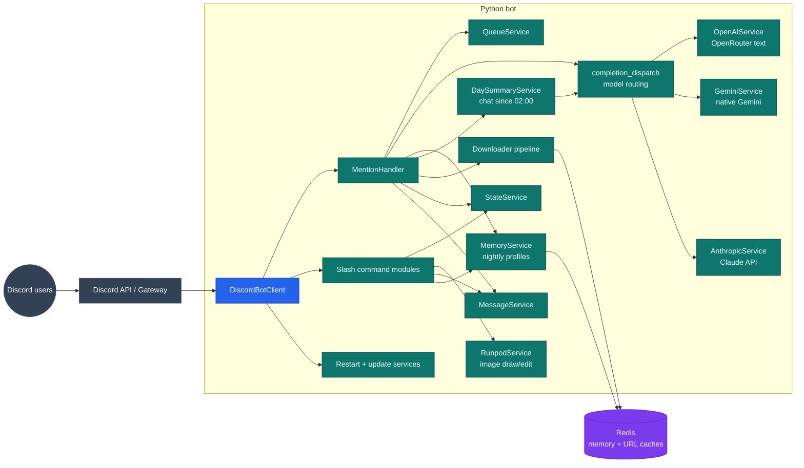
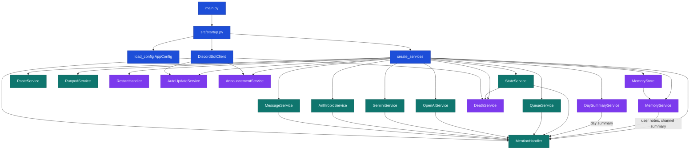
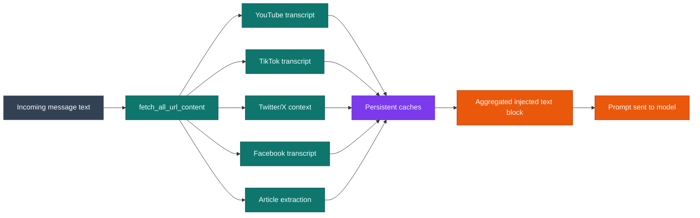
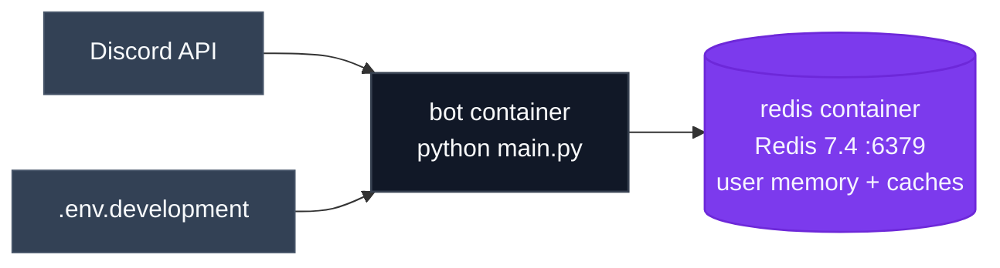

# Architecture

This page is meant to answer four questions quickly:

1. **What are the main moving parts?**
2. **How does a mention turn into a reply?**
3. **Which services are wired together at startup?**
4. **How do the bot and Redis fit together in development?**

## Read this page like a map

| Section | Use it when you want to... |
| --- | --- |
| System architecture | Orient yourself to the whole stack |
| Service wiring at startup | See what `src/startup.py` actually constructs |
| Mention pipeline | Understand the primary request path |
| Downloader enrichment flow | Understand where transcript/article data comes from |
| Docker/runtime layout | Visualize the development stack |
| Component map | Jump straight to the file you likely need |

## Diagram: system architecture

What it shows:

- the Python bot as the center of Discord interaction
- OpenRouter/Gemini/Claude API, Runpod, and downloader work around the mention path
- Redis for per-user memory and content caches



## Diagram: service wiring at startup

What it shows:

- `main.py` -> `src/startup.py`
- the services created by `create_services()`
- how those services are injected into the Discord client



## Diagram: mention pipeline

This is the single most important runtime path in the app.

```mermaid
sequenceDiagram
    autonumber
    actor U as Discord user
    participant C as DiscordBotClient
    participant Q as QueueService
    participant M as MentionHandler
    participant S as StateService
    participant D as downloader_utils
    participant DP as completion_dispatch
    participant O as OpenAIService
    participant G as GeminiService
    participant A as AnthropicService
    participant MS as MessageService
    participant MEM as MemoryService

    U->>C: Mention bot in channel
    C->>S: get_model(channel)
    C->>Q: queue_mention(message, bot_user, model)
    Q->>M: handle_mention(...)
    M->>S: mark_channel_active(channel)
    M->>M: build_chat_context (history, replies, embeds, attachments)
    M->>D: fetch_all_url_content(text) per message, concurrently
    D->>D: discover YouTube / TikTok / Twitter / Facebook / articles
    D-->>M: enrichment (newest 10 messages fetch; older ones use cache only)
    M->>S: get_system_prompt(channel)
    M->>MEM: get_notes_block(asker, mentioned users, recent speakers)
    MEM-->>M: profiles appended to the mention
    M->>DP: dispatch_completion(messages, model, system_prompt)
    alt model is google / google-high
        DP->>G: get_chat_completion(...)
        G-->>DP: reply content
    else model is sonnet/opus-5.5-direct
        DP->>A: get_chat_completion(...)
        A-->>DP: reply content
    else other models
        DP->>O: get_chat_completion(...)
        O-->>DP: reply content
    end
    Note over A,O: streamed: on_text(text so far) posts, then edits, a preview
    DP-->>M: reply content
    M->>MS: StreamingReply.finish: edit preview into final reply (or send it)
    MS-->>U: Discord reply
```

### What matters about this flow

- Mentions are **queued**, not processed in parallel ad hoc.
- Prompt context is more than just the latest message: it includes recent history, reply metadata, embeds, and attachments. The multimodal context array is built by `src/utils/chat_context.py` (`build_chat_context`).
- Model routing is centralized in `src/services/completion_dispatch.py`: `google`/`google-high` go to `GeminiService`, `sonnet-5.5-direct`/`opus-5.5-direct` go to `AnthropicService` (Claude API), and everything else goes to `OpenAIService`.
- URL enrichment happens **before** the LLM call and can materially change the prompt content. Only the newest 10 history messages fetch links; older messages use cached results only, and the fetches run concurrently.
- Per-user memory profiles are appended to the end of the mention, so the cached system prompt and history stay unchanged.
- Claude API and OpenRouter replies stream: `StreamingReply` (`src/services/streaming_reply.py`) posts the reply as it arrives and edits it at most every 1.5 seconds, then edits in the final text with the cost. If the request fails, the partial message is deleted before the error reply. Gemini replies arrive whole.
- There is no request/pipeline log table: the SDK clients use their default HTTP clients, and diagnostics go to the normal Python log (stdout and `logs/`).

## Diagram: downloader enrichment flow



### Current enrichment sources

| Source | Helper | Notes |
| --- | --- | --- |
| YouTube | `src/utils/youtube_utils.py` | Transcript extraction with optional proxy assistance |
| TikTok | `src/utils/tiktok_utils.py` | Thin wrapper over `src/utils/media_transcribe.py` (yt-dlp download -> Groq transcription) |
| Twitter/X | `src/utils/twitter_utils.py` | Tweet/context lookup, with optional video transcription path |
| Facebook | `src/utils/facebook_utils.py` | Thin wrapper over `src/utils/media_transcribe.py` (yt-dlp download -> Groq transcription) |
| Generic articles | `src/utils/url_utils.py` | `fetch_public` fetch, then `trafilatura` extraction (retried with `favor_recall` if the first pass finds nothing) |
| Shared media pipeline | `src/utils/media_transcribe.py` | yt-dlp or direct video download (3-minute limit) + proxy fallback, audio encoded at 16 kHz mono 32 kbps (what Whisper uses anyway; ~1h50m per 25 MB upload), longer audio split into 30-minute chunks, Groq Whisper transcription (near-instant). No length limit. Used by TikTok/Facebook/Twitter/Instagram and big Discord audio attachments |

### Fetching and caching

- Outbound fetches of user-supplied URLs go through `fetch_public` / `download_public` in `src/utils/http_client.py`. The SSRF guard (`src/utils/ssrf_guard.py`, which blocks every non-global address) is re-checked on each redirect hop, response bodies are size-capped, and each fetch has an overall timeout.
- Results are kept in Redis (`cmwgpt:cache:<name>:<key>`), each entry expiring 30 days after it was last used; image data URLs expire after 7 days. Tweet and Instagram caches still store images as base64. If Redis is down they fall back to memory.

## Diagram: docker/runtime layout



## Component map

| Path | Role | Open this when you need to... |
| --- | --- | --- |
| `main.py` | Boot entrypoint | See how process startup/shutdown begins |
| `src/startup.py` | Service factory | Understand the dependency graph |
| `src/config.py` | Config loading/defaults | Confirm env vars and defaults |
| `src/bot/client.py` | Discord client orchestration | See event handlers, command setup, service startup/shutdown |
| `src/bot/handlers/mention.py` | Main conversational path | Debug context assembly or mention behavior |
| `src/bot/commands/` | Slash commands | Inspect user-facing command behavior |
| `src/utils/chat_context.py` | Multimodal context builder | Change how history/embeds/attachments become the model input |
| `src/services/completion_dispatch.py` | Model routing | Understand Gemini/Claude API/OpenRouter selection |
| `src/services/openai_service.py` | Text-model integration | Understand OpenRouter calls |
| `src/services/gemini_service.py` | Native Gemini integration | Understand `google`/`google-high` calls and the Gemini timeout |
| `src/services/runpod_service.py` | Image integration | Understand draw/edit requests |
| `src/services/state_service.py` | Per-channel persistence | See where model/system-prompt/service settings live |
| `src/services/queue_service.py` | FIFO work queue | Understand serialized mention processing |
| `src/services/memory_service.py` | Per-user memory | Understand the nightly job, `/memory` edits, and the notes added to mentions |
| `src/db/memory_store.py` | Memory in Redis | Understand the memory keys and the 100 KB cap |
| `src/db/redis_client.py` | Redis clients | Debug Redis connectivity |
| `src/utils/http_client.py` | Guarded outbound fetches | Debug redirects, size caps, and fetch timeouts |
| `src/utils/cache_utils.py` | Redis-backed caches | Understand cache keys, TTLs and the in-memory fallback |

## End-to-end narrative

### Startup

1. `main.py` loads configuration and starts the app.
2. `src/startup.py` constructs the service graph.
3. `DiscordBotClient` receives those services, sets callbacks, registers commands, and boots Discord event handling.

### Mention reply

1. A user mentions the bot.
2. `DiscordBotClient` chooses the active model for the channel and queues the work.
3. `MentionHandler` gathers recent message history and reply context (via `build_chat_context`).
4. The handler enriches user text with downloader output for supported URLs and appends the memory profiles of the people involved.
5. `dispatch_completion` routes the assembled context to `OpenAIService` (OpenRouter), `GeminiService` (native Gemini), or `AnthropicService` (Claude API), based on the channel's model.
6. For Claude API and OpenRouter models the reply streams into a Discord message as it's written (`StreamingReply`); the final text, with its cost, is edited in at the end. Gemini replies are sent whole by `MessageService`.

### Memory

1. Every night, `MemoryService` reads the chat since its last run and replaces each person's profile at `cmwgpt:memory:<guild>:<user>` in Redis (one key per user, no history, max 100 KB).
2. `cmwgpt:memory_job:<guild>` tracks how far each server has been processed.
3. `/memory` and `/fillmemory` read and change the same keys (see `docs/commands.md`).

### Shutdown and restart

1. `startup.shutdown_services` stops background jobs, drains the queue (up to 90 seconds), closes the model/HTTP clients, and closes the Redis clients.
2. `/restart` (and auto-update) save state and `git pull` first, then run the same shutdown; `main.py` exits with code `42` so `start.sh` or the process manager starts the bot again.

## Key architectural traits

- **Mention-first UX:** the primary conversational surface is normal Discord chat, not a slash command.
- **Service composition over globals:** `src/startup.py` explicitly wires the main collaborators.
- **Small storage footprint:** Redis holds per-user memory (one key per user) and URL results; channel settings live in state files.
- **Python only:** the whole runtime is the Python bot; there is no separate web UI.
