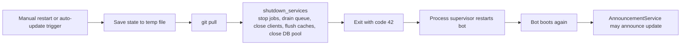

# Auto-update and restart behavior

This page explains the bot's **git-aware restart model** so it feels predictable instead of spooky.

## The three moving parts

| Component | Responsibility |
| --- | --- |
| `AutoUpdateService` | Listens for a signed deploy webhook from GitHub Actions and triggers a restart |
| `RestartHandler` | Saves state, pulls code, runs the normal shutdown, and exits with restart code `42` |
| `AnnouncementService` | Announces relevant updates after the bot comes back up |

Relevant code:

- `src/services/auto_update_service.py`
- `src/services/restart_handler.py`
- `src/services/announcement_service.py`

## The config switches that matter most

| Variable | Meaning |
| --- | --- |
| `DEPLOY_WEBHOOK_SECRET` | Shared HMAC secret; when set, the bot listens for deploy webhooks. Empty disables it |
| `DEPLOY_WEBHOOK_HOST` / `DEPLOY_WEBHOOK_PORT` | Where the listener binds (default `0.0.0.0:8787`) |
| `QUIET_UPDATES=true` | Suppress update announcements after restart |
| `QUIET_UPDATES=false` | Allow update announcements when appropriate |

## Diagram: restart lifecycle



## What actually happens during a restart

The restart path is intentional and stateful:

1. the bot marks restart as in progress
2. it saves state to a temp file
3. it performs `git pull`
4. it runs the normal shutdown sequence (`startup.shutdown_services`): stop background jobs, drain the queue for up to 90 seconds so in-flight replies finish, close the model/HTTP clients, flush caches, and close the DB pool
5. `main.py` exits with code `42`

That exit code is a signal to the **outer supervisor**, not an error to be ignored.

## Manual restart: `/restart`

The `/restart` command uses the same restart handler as the auto-update path.

That means `/restart` is effectively:

- save state
- `git pull`
- normal shutdown
- exit for supervised restart

If you expected “just restart the process,” that is not what this command does.

## Automatic updates (deploy webhook)

There is no polling. The `deploy` job in `.github/workflows/ci.yml` runs after the test job passes on a push to `main` and POSTs to the bot:

```
POST /deploy
X-Deploy-Timestamp: <unix seconds>
X-Deploy-Signature: sha256=<hex HMAC-SHA256 of "<timestamp>.<body>">
{"sha": "<commit>", "ref": "refs/heads/main"}
```

The bot rejects bad signatures and timestamps more than 5 minutes off (401). If the sha is the one already running it answers `up-to-date`; otherwise it queues the normal restart (`202`), which `git pull`s the new code.

### Setup

1. Generate a secret: `openssl rand -hex 32`.
2. On the bot host, put it in `.env` as `DEPLOY_WEBHOOK_SECRET` (and set `DEPLOY_WEBHOOK_PORT` if `8787` is taken), then restart the bot. Open that port in the host firewall.
3. In the GitHub repo, under Settings → Secrets and variables → Actions, add:
   - `DEPLOY_WEBHOOK_SECRET`: the same value
   - `DEPLOY_WEBHOOK_URL`: e.g. `http://polar.jobe.wtf:8787/deploy` (or an `https://` URL if a reverse proxy fronts it)

Without both Actions secrets, the deploy job skips itself. The curl retries for about 90 seconds so a push that lands while the bot is still restarting from the previous one still gets through.

Test it by hand from any machine with the secret:

```bash
body='{"sha":"manual","ref":"refs/heads/main"}'; ts=$(date +%s)
sig=$(printf '%s.%s' "$ts" "$body" | openssl dgst -sha256 -hmac "$DEPLOY_WEBHOOK_SECRET" -r | cut -d' ' -f1)
curl -X POST http://polar.jobe.wtf:8787/deploy -H "X-Deploy-Timestamp: $ts" -H "X-Deploy-Signature: sha256=$sig" --data "$body"
```

### Good environments for auto-update

| Environment trait | Why it helps |
| --- | --- |
| Real git checkout | The service fetches/pulls from git |
| Stable remote/auth configuration | Updates must be retrievable |
| Supervisor-managed process | The bot exits during restart |
| Predictable working directory | Git commands depend on it |

### Bad environments for auto-update

| Environment trait | Why it is risky |
| --- | --- |
| Read-only or immutable deploy | `git pull` is not the right update mechanism |
| No supervisor | Bot exits and stays down |
| Detached/unmanaged working tree | Git update behavior becomes unreliable |

## Update announcements after restart

`AnnouncementService` decides whether to broadcast an update notice after startup.

### Important nuance

An announcement is not sent just because the bot restarted.

The service checks things like:

- whether `QUIET_UPDATES` is enabled
- whether the current git SHA changed
- whether there are active channels to announce to
- whether the changelog contains announcement-worthy commits

If no relevant changelog is found, the service can intentionally skip the announcement.

## Recommended usage by environment

| Environment | Recommendation |
| --- | --- |
| Local development | Leave `DEPLOY_WEBHOOK_SECRET` empty and use `make run-direct` |
| Long-running self-hosted bot | Auto-update can be reasonable if git and supervision are set up well |
| Production-like managed environment | Enable only if git-pull-based updates are truly part of the deployment model |

## Important local-development caveat

The repository's `start.sh` wrapper uses `.venv/` (or a legacy `venv/`). After each exit `42` it reinstalls `requirements.txt` and starts the bot again; any other exit code ends the loop.

If you do not want restarts to reinstall dependencies or loop, skip the wrapper and use `make run-direct`.

## Practical mental model

- `/restart` is a **git-aware restart**, not a simple reload
- exit code `42` is **expected** during restart
- a process supervisor is part of the design
- announcements are **conditional**, not guaranteed

## See also

- `docs/deployment.md`
- `docs/development.md`
- `docs/troubleshooting.md`
